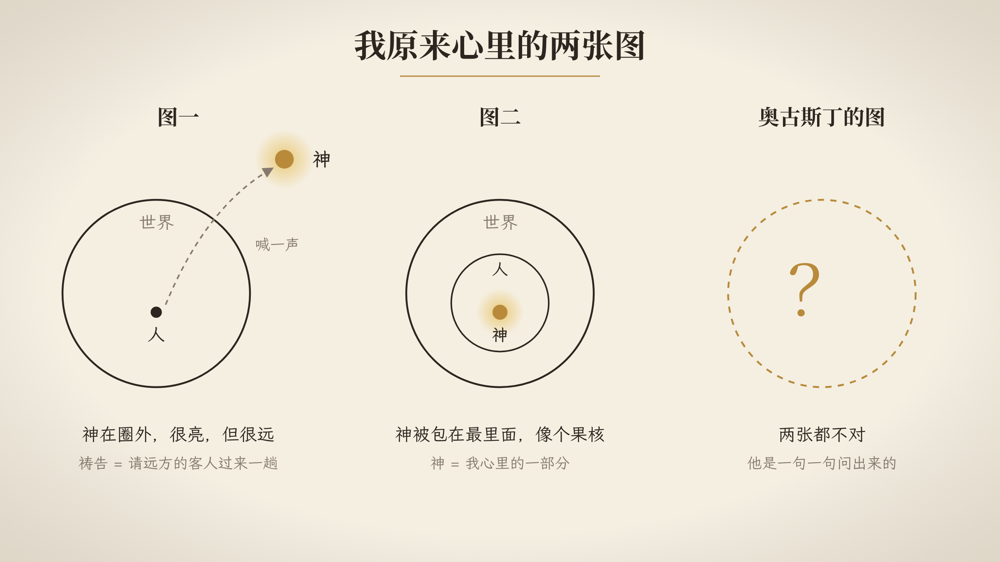
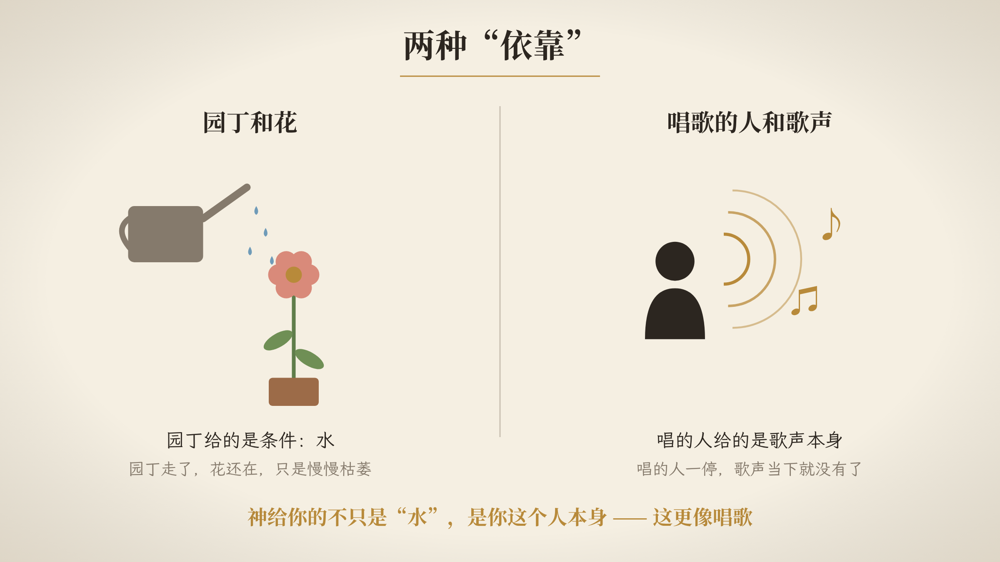
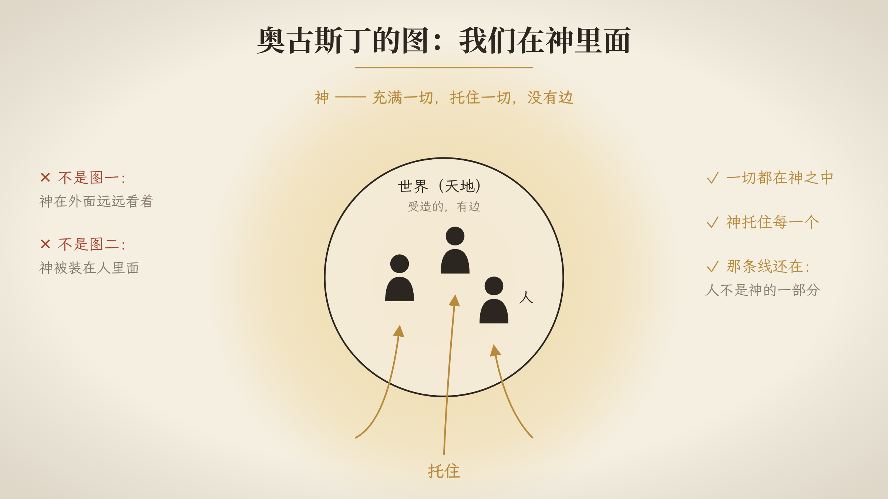
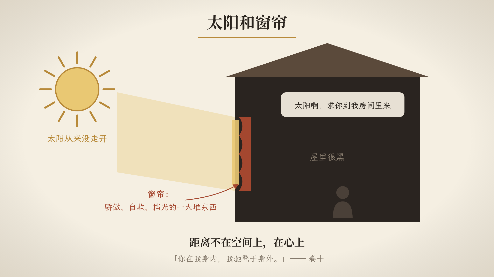

# 《忏悔录》逐句精读 · 卷一 第二章（口播稿）

**我请你来，可我本来就在你里面**

> 原文用周士良译本（商务印书馆）。本章原文分 12 句，按书上的顺序一句一句读，一句不落，引号里的原文都逐字对过。书里的"天主"就是神，"呼吁"就是我们平常说的呼求。圣经引文用和合本。【】里是给你的提示，不念。标题只是分段，也不念。图是讲解用的示意图，做视频时可以直接放进画面。

---

## 开头

上一次我们读完了第一章。最后我留了个尾巴：第二章奥古斯丁要问一个更奇怪的问题。我求神到我这里来，可我要是不在祂里面，我压根就不存在，那我到底在求什么？

我还说，这个问题我以前理解错了。今天先说我错在哪儿。

你在教会里，有没有听过、或者自己说过这样的祷告：

"主啊，求你今天来到我们中间。"
"圣灵啊，求你降临在这个地方。"
"主啊，求你进到我心里。"

我说过很多次，说得很顺口。从来没想过，这几句话背后，我心里其实有一张图。

后来我发现，一个人怎么祷告，最能暴露他心里的神是什么样子。你嘴上背的教义可能很标准，可你跪下来的时候，你觉得神在哪儿、离你多远、你得怎么喊祂才听得见，这些比教义更诚实。

## 我原来心里的那张图

这张图，我后来把它画下来了。

一个大圆圈，是世界。人在世界里面，是一个小点。神呢？在圆圈外面，也是一个点，很亮，离得挺远。

所以祷告是什么？就是隔着老远喊一声，请那个亮点过来，进到这个圆圈里，最好进到我这个小点里面。

说白了，神是一位很重要、但住得比较远的客人。平时各过各的，有事了，请祂来一趟。

这张图有个后果：平时的日子跟神没什么关系。上班、吃饭、刷手机，那是我自己的事；只有出了事，才想起来打个"紧急电话"。

还有一种图，正好反过来：神在人里面，人在世界里面，一层套一层，神被包在最中间，像个果核。

这张图听上去很属灵，"神就在你心里"嘛。可它也有个后果：神慢慢就变成了我心里的一部分。我的感觉、我的良心、我"最好的那个自己"。到最后，"听神的声音"和"听自己的声音"，就分不太清了。

第一张图，神太远了。第二张图，神太小了。

这两张图，奥古斯丁都不同意。他心里那张图长什么样，他没有直接画给你。他是一句一句问出来的。我们就跟着他，一句一句问。

你可以先停下来想一想：你自己心里那张图，是哪一种？

## 第一句

> "向天主呼吁，就是请天主降至我身，那末我将怎样向我的天主，向我的主、天主呼吁？"

还记得第一章最后一句吗？"主，请使我向你呼吁。"绕了一大圈，他总算想通了：我能呼求你，是因为你先开了口。好，那就呼求吧。

第二章第一句，他真要开口了。可他没急着说，先停下来琢磨"呼吁"这两个字。

他说，呼求神，就是请神"降至我身"，到我这儿来。

这个理解很正常，就是我们平时祷告的意思。"主啊，求你来。"

然后他问："那末我将怎样向我的天主呼吁？"注意，他问的不是该说什么话，他问的是"怎样"。请神到我这儿来，这到底是怎么一回事？神从哪儿来？来到哪儿？

你看，这就是奥古斯丁读起来累人、也读起来过瘾的地方。别人顺嘴就过去的一句话，他非要停下来，拿在手里翻来覆去地看。

还有个小地方："向我的天主，向我的主、天主"。称呼叠了好几层。一个人刚明白过来自己是在跟谁说话，叫一声不够，要多叫几声。

## 第二句

> "我心中是否有地方足以使我的天主降临，使创造天地的主宰降至我身？"

他琢磨的第一件事，是地方够不够。

请人来，总得有地方让人家待。请的是谁？"创造天地的主宰"。

这有点像你请一位贵客来家里吃饭，人家答应了，你才想起来，自己住的是一间十平米的出租屋。再一看这位客人，是太平洋。

就像我在深圳住在很小很小的出租屋中，我是不敢叫人到我这里来做客的，第一是怕我招待不好他，第二是我怕他会嫌弃我住的地方。

你看，这里其实有两种怕。

一种是怕招待不好：地方太小，东西太少，配不上人家。

一种是怕被嫌弃：不光是小，是乱，是破，是有些角落见不得人。

奥古斯丁两种都怕。这一句和下一句，问的是"装不装得下"；到了第五章，他说得更直白，几乎就是在描述一间出租屋："我的灵魂的居处是狭隘的，不相称你降来，请你加以扩充。它已经毁败，请你加以修葺。它真是不堪入目：我承认，我知道。"

狭隘，毁败，不堪入目。可他没有因此就不请了。他的办法是：求这位客人自己动手，把屋子扩建了，修好了，打扫干净了。

后来，神真的来了。你知道祂选了一个什么地方吗？路加福音第二章："就生了头胎的儿子，用布包起来，放在马槽里，因为客店里没有地方。"

"客店里没有地方"。奥古斯丁问"我心中是否有地方"，两千年前的伯利恒，答案就是：没有地方。

可祂还是来了，来到了一个比出租屋还小、还脏的地方，一个喂牲口的槽。

所以你那间不敢请人进来的屋子，神不嫌弃。祂出生的地方，比它还差。

你可以停下来想一想：你心里有没有一间"不敢请人进来"的屋子？

## 第三句

> "主、我的天主，我身上真的有可以容纳你的地方吗？"

同一个问题，他又问了一遍。这次多了两个字："真的"。

上一句还像是在自己心里盘算，这一句是转过身来，对着神问的："主、我的天主"。

读到这儿，我想起新约里一个人。有个百夫长，他的仆人病了，耶稣说我去你家吧。百夫长说："主啊，你到我舍下，我不敢当。"

这里我想把两个问题分开，因为它们很容易搅在一起。

一个是"装不下"。这是因为我小，我有限。可有限不是罪。神造人本来就是有限的，这不丢人，也不需要谁来赦免。

另一个是"不配"。这是因为我脏，我有罪。这个才是真问题，这个才需要赦免。

奥古斯丁这两个都在问。"装不装得下"，他这一章后面和下一章都在回答：神根本不是那样待在一个地方的。可"配不配"，靠想是想不通的，只能靠恩典。

你看百夫长，他说"我不敢当"，承认自己不配。耶稣怎么说？"这么大的信心，就是在以色列中，我也没有遇见过。"

承认自己不配，恰恰是信心的开始。

## 第四句

> "你所造的天地，复载我们的天地能容纳你吗？"

镜头一下子拉远了。我装不下，那天地呢？

"复载"，就是天在上面盖着我们，地在下面托着我们。我们整个人都在天地中间。可就连这个装着我们的天地，能装下你吗？

你注意他用的词："你所造的天地"。天地是神造的。一个被造的东西，要把造它的那一位装进去，这就好像要一幅画把画家装进画框里。

这个问题，所罗门早就碰到过。他建好了圣殿，那是当时最好的殿。献殿的时候他说："神果真住在地上吗？看哪，天和天上的天尚且不足你居住的，何况我所建的这殿呢？"

殿装不下，天地也装不下。

不过你注意，奥古斯丁在这儿只是把问题提出来，没有回答。天地装不装得下神，他留到第三章才细说。这一章，他先追着另一个念头往下走。

## 第五句

> "是否由于一切存在没有你便不能存在，为此凡存在的便容纳你："

这一句，我第一遍是真没看懂。

他的意思是：一切存在的东西，离了你都不能存在。那是不是可以说，每一样存在的东西里面，都"容纳"着你？

我在笔记里打了个问号。我当时想，这话不该反过来说吗？神那么大，是神装着万物，怎么成了万物装着神？

后来想明白了，卡就卡在"容纳"这两个字上。

我们一说容纳，脑子里就是一个容器：杯子容纳水，房间容纳人。容器在外面，东西在里面。

可"一切存在没有你便不能存在"，这半句说的不是容器。它说的是：每样东西里面都有你，带着你，靠着你。

我给自己打了个比方。一首交响乐，每一个音符里面都"有"作曲家的心思，整首曲子从头到尾都"带着"作曲家的构思。你可以说，这首曲子里"有"作曲家。

可你不能说作曲家被这首曲子装进去了。曲子演完了，作曲家还在；作曲家脑子里的东西，也远远不止这一首。

反过来，没有作曲家，这首曲子一个音都不会有。

万物和神，有点像这样。万物里处处有神的手笔，处处有神的同在，但万物没有把神装起来。万物是靠着神才有的，神不靠万物。

诗篇一百三十九篇说："我要称谢你，因我受造，奇妙可畏。"你身上，也处处是这位作曲家的手笔。

你再看，这一句最后是个冒号，话没说完。他从这儿马上推出一个结论，一个让他自己都愣住的结论。

【"交响乐"的比方出自你的笔记】

## 第六句

> "这样，我既然存在，何必要求你降至我身？因为除非你在我身上，否则我便无由存在。"

刚才说的是"一切"，现在他把镜头从"一切"拉到了"我"。

后半句先看。"无由存在"，就是没有办法存在。不是先有一个我，然后神偶尔来看看我。是神一直在我身上，我才存在。

希伯来书第一章说，神的儿子"常用他权能的命令托住万有"。"托住"，是一直在托，现在进行时。

保罗在雅典对一群哲学家说："我们生活、动作、存留都在乎他。"

《威斯敏斯特信条》第五章讲护理，开头的意思就是：神这位万物的创造主，托住、引导、安排、管理一切受造物和一切的事，从最大的到最小的。

改革宗为什么这么看重护理？因为它要对付一个很常见的想法：神像一个钟表匠，把世界造好，上好发条，就放手不管了，世界自己转。

奥古斯丁说不是这样的。这一秒你能坐在这里听我讲，是因为这一秒，神正托着你。

我们平常把"活着"当成默认值，把"死"当成意外。今天早上醒过来，谁会觉得这是件需要感谢的事呢？奥古斯丁把它倒过来了：存在本身，才是每一秒都在发生的恩典。

我画过一张图：一个方框是世界。神不在方框外面远远看着，祂的手伸进来，托着宇宙，托着地球，托着每一个人。把那只手拿开，什么都不剩。

【这张"手伸进来托着"的图出自你的笔记，第九句那张图里画出来了】

好，那前半句的问题就来了："我既然存在，何必要求你降至我身？"我能存在，就说明你一直在我身上。那我还求你"来"，这不是多此一举吗？

这个问题，就问到我们每个人的祷告上来了。先别急着回答，奥古斯丁自己也没急，他接着往下问。

## 第七句

> "我不在黄泉，而你在那里；即便'我进入地狱，你也还在那里'。"

"黄泉""地狱"，在和合本诗篇里叫"阴间"，就是死人去的地方。

他引的是诗篇一百三十九篇："我往哪里去躲避你的灵？我往哪里逃、躲避你的面？我若升到天上，你在那里；我若在阴间下榻，你也在那里。"

奥古斯丁的意思是：我现在还没下阴间，可就连阴间你也在。照人的想法，那是离神最远的地方，可连那儿都不是神够不着的地方。

那还有哪儿是你不在、需要你"降"过来的？没有。

这句话，对一个想躲开神的人，挺吓人的。约拿就试过，"约拿却起来，逃往他施去躲避耶和华"，结果一路逃进了鱼肚子里，神也在那儿。

可是对一个跑了很多年、现在想回家的人，这句话是安慰。你跑得再远，也没有跑出过祂的手掌心。

这里我要补一句，免得说偏了。神在阴间，不等于阴间里有祝福。神无所不在，可是祂的恩宠和祝福，不是哪儿都一样地给。这个区别，我们讲到第十一句还会再说。

【可以加：你自己"跑"的那几年，回头看，神其实一直都在】

## 第八句

> "我的天主，假如你不在我身，我便不存在，绝对不存在。"

"不存在"，他说了两遍，第二遍还加了"绝对"。一个修辞学教授不会随便重复，他是要把这个意思钉死。

神要是哪一刻不再托住你，会怎样？

我一开始的想法是：那我可能会慢慢变差，慢慢枯萎，像一盆没人浇水的花。

花没人浇水，还能撑几天，因为花本身还在，园丁给它的只是水。可神给你的不只是水，是你这个人本身。这更像唱歌：歌声只在有人唱的时候才有。唱的人一停，歌声不会慢慢变弱、慢慢死掉，它当下就没有了。

为什么会这样？因为圣经说，神是从无到有造了万物。我们不是从一块原料里被捏出来的，我们是从"无"里被叫出来的。所以我们没有一个"本来就有"可以退回去。离开神，我们退回去的地方不是"活得差一点"，是"无"。

死亡再可怕，也是发生在一个"还在"的人身上的事。可要是神不托住你，就连一个去经历"我没有了"的人都没有了。这就是奥古斯丁说的"绝对不存在"。

当然，这只是假设。神不会松手。就连人死了，灵魂也还在祂手里，将来还要复活。正因为祂一直托着，我们才一直"在"。

你可以停下来想一想：你此刻还在，说明什么？

## 第九句

> "而且'一切来自你，一切通过你，一切在你之中'，是否更可以说，我除非在你之中，否则不能存在？"

这一句是整章的转折，我们慢一点。

他引的是罗马书十一章三十六节，和合本译作："因为万有都是本于他，倚靠他，归于他。"

本于他：一切从祂来。
倚靠他：一切靠着祂存留。
归于他：一切都朝着祂去。

还记得第一章那句吗？"你造我们是为了你。"那个"为了你"，就是这里的"归于他"。

然后他说："是否更可以说"。你看，他在改自己的话。

前面一直说的是"你在我身上"，好像我是一个容器，你在里面。现在他说，更准确的说法应该反过来：不是你在我里面，是我在你里面。"我除非在你之中，否则不能存在。"

到这儿，奥古斯丁的那张图就出来了。

不是神在世界外面远远的一个亮点，也不是神被包在人的最里面。神是那个没有边的、充满一切的；世界在神里面，人在世界里面。神的手同时伸到世界和每一个人身上。

我在笔记上写了一句：神不在人里面被装着，也不独立在人外面不管。

这张图能同时挡住两个错误。

一个是把神推得太远，就是我那第一张图：神造完世界就走了，在外面远远看着。

一个是把神拉得太近，近到混在一起：神就是万物，或者神就是我心里的一部分，就是我那第二张图。

奥古斯丁在第三卷有一句话，把这两头都说到了："你幽邃沉潜，在我心坎深处之外，你又高不可及，超越我心灵之巅。"翻成白话就是：你比我心里最深的地方还深，比我心里最高的地方还高。比我自己离我还近，又比一切都高。

还有一条线，图里画出来了：世界那个圆是有边的。"我在你之中"，不等于"我是你的一部分"。就像一个孩子被父亲抱在怀里，孩子在父亲怀里，可孩子不是父亲身上的一块肉。第一章那句"我们的心如不安息在你怀中"，说的就是这个"怀中"。

创造主是创造主，受造物是受造物。这条线，整本圣经都没有抹掉过。

【这两句和这张图出自你的笔记，可以在这里把开头那两张图和这张并排讲】

## 第十句

> "主，确然如此，确然如此。"

这一句很短，可我很喜欢。

前面全是问号，一个接一个，像在辩论。到这儿突然停下来，就一句话："主，就是这样，就是这样。"

一个修辞学教授，什么题目都能正着说一遍、反着再说一遍。可是当他真的看见了，他不辩了，他说"是"。

这有点像我们说"阿们"。

而且你知道吗，他刚引的罗马书十一章三十六节，在保罗那里，本来就是一首赞美诗的结尾。前面是"深哉，神丰富的智慧和知识！他的判断何其难测！他的踪迹何其难寻！"最后是"愿荣耀归给他，直到永远。阿们！"

保罗讲道理讲到最深处，停下来说"阿们"。奥古斯丁引了保罗的话，也停下来，说"确然如此"。

还记得第一章那句"主啊，请使我得知并理解"吗？他是带着问题来到神面前的。现在问题想通了，他还是对着神说。想不明白的时候祷告，想明白了，还是祷告。神学的终点不是一个结论，是一声"阿们"。

你可以停下来想一想：你读圣经，最后是停在"我懂了"，还是停在"阿们"？

【可以加：你哪一次读经，读着读着突然明白了，心里冒出一句"原来是这样"】

## 第十一句

> "那末既然我是在你之中，我更从何处向你呼吁？你从何处降至我身？"

问题绕回来了，这次问得更尖。

我们平常说"呼求"，背后是一个距离：我在这儿，你在那儿，我喊一声，你过来。可要是我本来就在你里面，那我站在哪儿喊你？你又从哪儿过来？

这里我要小心一点，把话说清楚。圣经里讲神的"同在"，其实有两种：

| | 托住万物的同在 | 恩典的同在 |
|---|---|---|
| 谁有 | 一切受造物：信的、不信的，石头、星星、细菌 | 神的儿女 |
| 是什么 | 神作为创造主，托住、维持一切 | 神与人和好、同住、相交 |
| 圣经 | "我们生活、动作、存留都在乎他" | "我们要到他那里去，与他同住" |
| 会不会"离开" | 不会，一秒都不会 | 神不撇下自己的儿女；可人会背过身去，感觉不到 |

奥古斯丁前面说的"你在我身上""我在你之中"，是左边那一种。

右边那一种，是耶稣说的："人若爱我，就必遵守我的道；我父也必爱他，并且我们要到他那里去，与他同住。"这是救恩里一份特别的恩典，不是每个存在的东西都有。

所以奥古斯丁不是说"祷告没用"，更不是说"求你来"这种话不能说。他是在逼我们想清楚：我们求"你来"，求的到底是什么？

这一章他没有直接回答。答案他留到了第十卷。那时候他回头看自己信主前的那些年，写了一段很有名的话：

"我爱你已经太晚了，你是万古常新的美善，我爱你已经太晚了！你在我身内，我驰骛于身外。"

还有一句："你和我在一起，我却不和你相偕。"

你看，距离是有的，可不在空间上，在心上。不是神不在，是他不在。神一直在他里面，他却一直往外跑。

我自己是用一个画面想明白的。

一个人坐在一间黑屋子里。外面是大太阳，可他屋里拉着厚厚的窗帘。他跪下来祷告：太阳啊，求你到我的房间里来。

太阳从来没走开过，一直照着这座房子，照着整个世界。屋子黑，不是因为太阳没照，是因为窗帘拉着。

所以他真正该求的，不是"太阳你过来"，是"求你把我这窗帘拉开"。

这个窗帘是什么？就是我们的心远离了神。是骄傲，是自欺，是我们拿来挡光的那一大堆东西。

启示录里，主耶稣说："看哪，我站在门外叩门，若有听见我声音就开门的，我要进到他那里去。"保罗在雅典也说："其实他离我们各人不远。"

所以祷告不是把一位远方的神请过来。祂一直都在。祷告是一个人在恩典里转过身来，承认：你一直是我生命的源头，是我一直背对着你。

还得加一句。连这个"转过身来"，也不是我自己转的。第一章讲过了：是你鼓动的，是你使我呼求的。窗帘，也是祂帮着拉开的。

你可以停下来想一想：你的窗帘是什么？

【"窗帘和太阳"的比方出自你的笔记】

## 第十二句

> "我的天主，你曾说：'我充塞天地'，我岂将凌跨天地之外，使你能降来我身？"

"我充塞天地"，出自耶利米书二十三章："耶和华说：人岂能在隐密处藏身，使我看不见他呢？耶和华说：我岂不充满天地吗？"

"凌跨天地之外"，就是跳到天地外面去。

他这个问题，其实有点幽默。你要神"过来"，那你得先站在一个神不在的地方吧？神充满天地，那你只能先跳出天地。跳得出去吗？跳不出去。就算跳得出去，那外面又是谁造的？

所以"请神从别处过来"，这个想法本身就站不住。

## 收尾

第二章读完了。我想把它收成三句话。

第一句：你能存在，就说明神正托着你。这一秒是，下一秒也是。

第二句：不是神在我里面被装着，是我在神里面被托着。

第三句：祷告不是把一位远方的神请过来，是在恩典里转过身来，把窗帘拉开，承认祂一直都在。

最后还是留一个问题，是我自己在想的。

我心里那张图，到现在是不是还是老样子：神在圈外面，一个很亮、但很远的点？

要是这样，那我今天该做的，也许不是更大声地喊"主啊，你快来"。是先承认一件事：主啊，你一直都在。是我一直拉着窗帘。

下一次读第三章。奥古斯丁刚引了"我充塞天地"这四个字，他马上又追问下去：你充满天地，是像水装满一个瓶子那样吗？要是天地这个瓶子装满了，多出来的那部分去哪了？还有，瓶子要是碎了呢？
