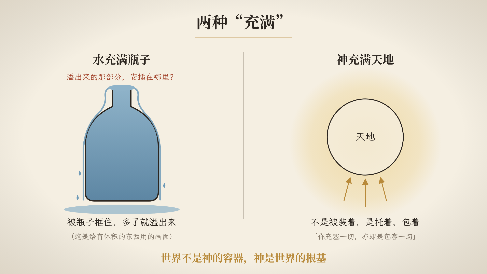
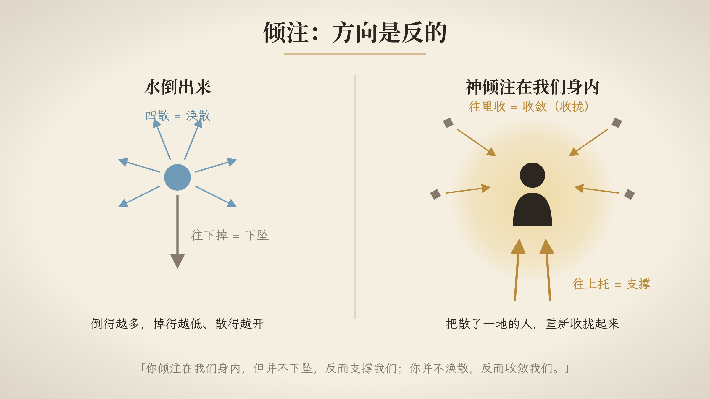
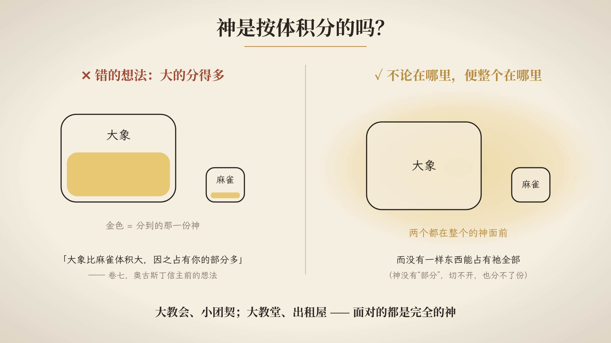

# 《忏悔录》逐句精读 · 卷一 第三章（口播稿）

**瓶即使破碎，你并不散溢**

> 原文用周士良译本（商务印书馆）。本章原文分 9 句，按书上的顺序一句一句读，一句不落，引号里的原文都逐字对过。书里的"天主"就是神。圣经引文用和合本。【】里是给你的提示，不念。标题只是分段，也不念。图是讲解用的示意图，不用念，做视频时可以直接放进画面。
>
> 念的时候注意一件事：奥古斯丁是对着神说话的，原文里的"你"都是指神。讲解的部分，凡是指神的地方都直接说"神"；讲解里的"你"，都是指听的人。

---

## 开头

上一次读第二章，奥古斯丁把我心里的一张旧图拆掉了。

我原来以为，神在世界外面，是远处一个很亮的点，祷告就是隔着老远，请祂过来。奥古斯丁把这张图翻了过来：不是我把神请进来、装在我里面，是我本来就在神里面，被祂托着。我这一秒还活着，就是因为祂这一秒还托着我。

第二章最后，他引了耶利米书里神的一句话："我充塞天地。"第三章，就从这四个字开始。

开始之前，我想先问你一个问题。

你想象"神无所不在"的时候，脑子里是个什么画面？

我问过自己。我脑子里出来的是空气：神像空气一样，弥漫在整个宇宙里。也有人想到的是光，或者是一片海。

这些画面都不坏，人想事情，总得借一个画面。可是奥古斯丁这一章，就是要把这些画面一个一个拿出来试，试到它们露馅为止。

为什么要这么较真？因为脑子里的画面，用久了，会悄悄变成一尊偶像。不是木头刻的，也不是石头雕的，是我们自己想出来的。《威斯敏斯特大要理问答》讲第二条诫命的时候就说：被禁止的，不只是在外面给神造像，也包括在心里给神造像【大意】。

我们一句一句看，他是怎么试的。

## 第一句

> "既然你充塞天地，天地能包容你吗？"

这个问题，第二章第四句其实问过一次："复载我们的天地能容纳你吗？"当时他没有回答，先放下了。现在他又捡了回来，还多了一个前提：神充满天地。

这样一来，最自然的画面就出来了：天地像一个大瓶子，神像水，倒满了。

可要是这样，瓶子多大，水就有多少。天地有多大，神就有多大。

你可以停下来想一想：你心里的神，是不是也正好跟这个世界一样大？

## 第二句

> "是否你充塞天地后，还有不能被天地包容的部分？你充塞天地后，余下的部分安插在哪里？"

这个问题，问得有点调皮。

还是那个画面：天地是个大瓶子，神是倒进去的水。水倒满了，多出来的那部分去哪儿了？流到天地外面去了？那天地外面又是哪里？他问"余下的部分安插在哪里"，问的就是这个。

我第一次读，觉得他在钻牛角尖。读着读着才发现，他是故意的。他拿"水倒进瓶子"这个画面，一直往下推，推到荒唐的地步，让你自己发现：这个画面本身就错了。

神不是一块一块的。神没有"一部分在里面，一部分溢出来"这回事。"溢出来"这个词，是给水、给有体积的东西用的，用到神身上，就不对了。

这是奥古斯丁很厉害的一招。他不直接告诉你"你错了"，而是陪着你，把错的想法走到底，让你自己撞上墙。

## 第三句

> "是否你充塞一切，而不须被任何东西所包容，因为你充塞一切，亦即是包容一切？"

这一句，就是把刚才那个问题翻过来，给出的答案。

不是天地包容神，是神包容天地。

"充满"这个词，其实有两种意思。

一种是水充满瓶子：占地方，被框住，倒多了就溢出来。

一种是神充满天地：不占地方，也不被框住。祂充满万有，是托住万有、承载万有。歌罗西书说："他在万有之先，万有也靠他而立。"

这句经文，我在笔记上抄了一遍，旁边写了一行字：世界不是神的容器，神是世界的根基。

你想一想一栋楼和它的地基。楼不能说"我把地基装在里面了"。是地基托着楼。楼盖多高、盖多大，都是地基撑起来的。

我们平常想到"神无所不在"，脑子里常常是一种稀释的画面：神像空气一样，摊开在整个宇宙里，每个地方分到薄薄的一层。

奥古斯丁说，不是这样。这一点，他在这一章的后半段还要细说。

【"世界不是神的容器"这句出自你的笔记】

## 第四句

> "一只瓶充满了你，并没有把你固定下来，瓶即使破碎，你并不散溢。"

这一句，我特别喜欢。

我们常说"神充满我"，好像我是一只瓶子，神是装在里面的东西。奥古斯丁说：就算一只瓶子被神充满了，神也没有被这只瓶子固定住。瓶子碎了，神也不会洒一地。

你想想这句话的分量。

人这只瓶子，是会碎的。会生病，会变老，会失败，会在某一天彻底垮掉。我们的身体会碎，我们的计划会碎，我们的家，有时候也会碎。

可是瓶子碎了，神没有跟着碎，也没有跟着洒掉。我们的破碎，伤不到神。

保罗也用过瓶子的比方。他说："我们有这宝贝放在瓦器里，要显明这莫大的能力是出于神，不是出于我们。"瓦器，就是泥土烧的罐子，很便宜，一摔就碎。

他接着又说："我们四面受敌，却不被困住；心里作难，却不至失望；遭逼迫，却不被丢弃；打倒了，却不至死亡。"

罐子一直在裂，宝贝一直没丢。

诗篇七十三篇也有一句："我的肉体和我的心肠衰残；但神是我心里的力量，又是我的福分，直到永远。"

对一个心里正在碎的人来说，这是很实在的安慰。你可以碎，神不会碎。你碎了，托着你的那一位，也不会松手。

你可以停下来想一想：你最近，有没有哪一块正在碎？

## 第五句

> "你倾注在我们身内，但并不下坠，反而支撑我们；你并不涣散，反而收敛我们。"

这一句，是把刚才"水倒进瓶子"的画面，整个倒过来用。

"倾注"这个词，会让人想起约珥书里的一句话："我要将我的灵浇灌凡有血气的。"

水倒出来，是往下掉的，这就是"下坠"。水倒得越多，散得越开，这就是"涣散"。

神倾注在我们里面，方向却是反的：不是往下掉，是往上托；不是散开，是把我们收拢起来。

我在笔记里写了三句话，算是我对这一句的理解：

神临在人里面，不是为了掉下来，是为了使人站立，扶持人。
神不是被动地进来，是主动地支撑人。
人不是靠自己存在，是被神托住。

"收敛"这两个字，我想多说一句。周士良先生这里用的"收敛"，不是"收敛脾气"的那个收敛，是收拢、聚起来的意思。

一个离开神的人，是什么样子？奥古斯丁在第二卷一开头，说他为什么要回想自己的过去，是"为了请你收束这支离放失的我、因背弃了独一无二的你而散失于许多事物中的我"。

支离放失，散失在许多事物中。一会儿往名声那边跑，一会儿往情欲那边跑，一会儿又往哲学那边跑，整个人四分五裂。

为什么离开神，人就会散？因为人心里，本来该有一个中心。中心没了，人就什么都想抓。抓住什么，心就被什么扯过去。抓的东西越多，心就被扯得越碎。

神来，是把散了一地的人，重新收拢起来。

【第一集里你讲过，到了深圳的第一晚，"自己却破碎了一地"。这里可以接上：瓶子碎了，神没有洒；人散了一地，是神来收拢的】

【三句笔记出自你的笔记】

## 第六句

> "但你充塞一切，是否你全体充塞一切？"

第三章到这里，另起了一段。前面问的是，天地装不装得下神。现在他问得更细了：神充满万物，是整个的神在那里，还是神的一部分在那里？

你看他问问题的方式，像剥洋葱，一层一层往里剥。接下来，他一口气列了几种可能。我先说个大概，你心里有个数。

第一种：万物都只装了神的一部分，而且装的是同一部分。

第二种：万物各装一部分，大的装得多，小的装得少。

最后是奥古斯丁自己的回答：神不论在哪里，都是整个地在那里。

前两种都走不通。我们一种一种看。

## 第七句

> "是否一切不能包容你全体，仅能容纳你一部分，而一切又同时容纳你的同一部分？"

第一种可能：万物装不下整个的神，只装了神的一部分，而且大家装的，都是同一部分。

你想一下这个画面。好像神切下来一块，放进世界里，全世界共用这一块。那剩下的神呢？在哪儿？

这又回到了刚才那个问题："余下的部分安插在哪里？"所以，走不通。

## 第八句

> "是否各自容纳一部分，大者多而小者少？这样你不是有大的部分和小的部分了？"

第二种可能：每样东西各装一部分，大的装得多，小的装得少。

这个想法其实很自然。很多人心里就是这么想的，包括奥古斯丁自己。他在第七卷里坦白过，他信主以前，就是这么想的：

"天地大的部分占有你的大，小的部分占有你的小；万物都充满了你，则大象比麻雀体积大，因之占有你的部分多，如此你便为世界各部分所分割，随着体积的大小，分别占有你多少。其实并不如此。"

大象比麻雀分到的神多。你听了可能想笑。可是我们换个说法，就笑不出来了。

大教会比小团契分到的神多。大教堂比出租屋分到的神多。有名的牧师，比坐在最后一排的弟兄姊妹，分到的神多。

我们嘴上不会这么说，心里有时候却是这么想的。所以我们会觉得，去了大教会，神好像近一点；在家里一个人祷告，神好像只来了一小份。

所以奥古斯丁问："这样你不是有大的部分和小的部分了？"神要是能按体积分，那神就成了一样有大小、能切开的东西。那祂就不是神了，只是一个很大的东西而已。

《威斯敏斯特信条》第二章讲神，说神是至纯的灵，没有身体，也没有部分【大意】。神不能被切开，也不能按份分。

我开头说，我原来心里的那张图是错的，就错在这儿。我心里那个"远处的亮点"，就是一个有大小、有位置的神。奥古斯丁在这里拆掉的，正是这张图。

你可以停下来想一想：你心里，是不是也有"大份的神"和"小份的神"？

## 第九句

> "或是你不论在哪里，便整个在哪里，而别无一物能占有你全体？"

最后这一句，就是他的答案。虽然还是用问号，可意思已经很清楚了。

神在任何地方，都不是"一部分的神"，而是完全的神。

你在家里祷告，神不是分了一小块在你家；你在医院的走廊上祷告，神也不是分了一小块在医院。神在你家，是整个地在；在医院，也是整个地在。

同时，没有任何一样东西，能把神全部占有。不是这个教会，不是这座城市，也不是这个宇宙。

这两句放在一起，有一种很奇妙的张力。

一方面，神不会被任何地方、任何东西、任何人独占。我们没法把神请到自己家里锁起来，变成自家专用的神。

另一方面，神在你身边的时候，不是打了折扣的神，也不是"分给你的那一小份"。你面对的，是完全的神。

奥古斯丁在第三卷里，讲到他的母亲。那些年他走得很远，他母亲天天为他哭。有一次，神给了她一个梦，安慰她。奥古斯丁写到这件事，对神说了一句话：

"你照顾着每一人，仿佛只照顾一个人，你照顾全人类，犹如照顾一人。"

你想想，这句话放在第三章后面读，是什么味道。神不是一块蛋糕，人一多，每个人就分得少。祂照顾你，就像只照顾你一个人。

所以，你不用跟别人抢神。神不会因为照顾了别人，就少照顾你一点。

你可以停下来想一想：你有没有觉得，神太忙了，顾不上你？

## 收尾

第三章读完了。我想把它收成三句话。

第一句：世界不是神的容器，神是世界的根基。

第二句：瓶子会碎，神不会碎；人会散，神来收拢。

第三句：神不按大小分。不管你在大教堂，还是在出租屋，你面对的，都是完全的神。

最后，还是留一个问题，是我自己在想的。

我心里是不是还在悄悄地"按体积分神"？觉得在某些地方、某些人身上，神多一点；在我这儿，神少一点？

要是这样，我也许该换一个祷告。不是"主啊，再多给我一点"，而是"主啊，你在这里，是整个地在这里。求你开我的眼睛，让我看见"。

下一次读第四章。奥古斯丁说完"你不论在哪里，便整个在哪里"，接着问了一个更直接的问题："我的天主，你究竟是什么？"然后他写了一长串："至高、至美、至能、无所不能、至仁、至义、至隐、无往而不在……"越写越停不下来。下一次我们就来看，他为什么停不下来。
